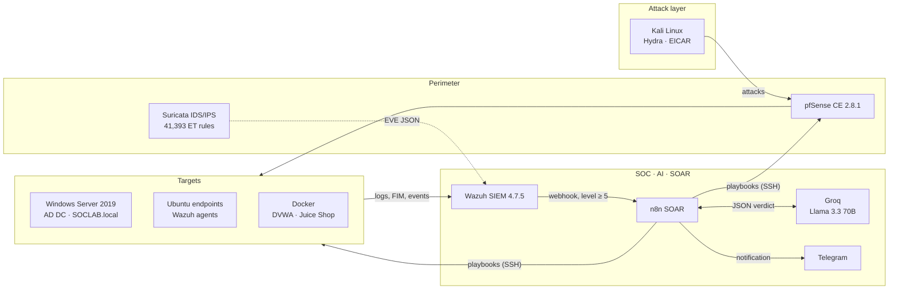
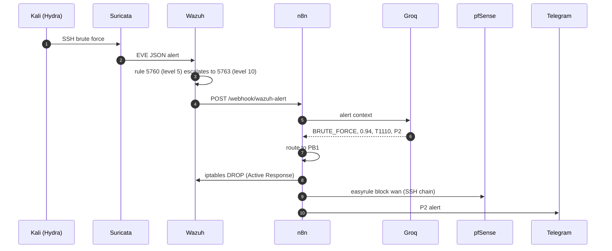

<div align="center">

# SOCPilot AI

**An AI-assisted Security Operations Center: from detection to automated response in seconds, built entirely on open-source tools.**


</div>

---

## Overview

Traditional SOCs drown in alerts. The project report cites a median manual response time of about 11 minutes, with roughly 70% of alerts going unreviewed.

**SOCPilot AI** closes that gap with a four-layer pipeline:

1. **Detect:** Wazuh (SIEM/XDR) and Suricata (network IDS) collect and correlate events from Linux, Windows Active Directory, and the network.
2. **Understand:** every alert of level 5 or above is sent to **Llama 3.3 70B (via Groq)**, which returns a structured verdict: attack type, confidence, severity, MITRE ATT&CK technique, priority, and recommended playbook.
3. **Decide & respond:** an **n8n** SOAR workflow routes the verdict to one of six playbooks (blocking an IP on the host and on the pfSense firewall, disabling an Active Directory account, killing a process, and so on).
4. **Notify & audit:** a structured Telegram alert is sent and every incident is logged as JSON.

The whole lab (7 VMs across 3 physical machines) is interconnected through a ZeroTier mesh VPN and uses only open-source components.

> Final-year project (PFE), Licence in Computer Engineering, Information Systems Security department, 2025–2026.

## Results

| Metric | Target | Measured in lab |
|---|---|---|
| End-to-end response time, SSH brute force | < 11 s | **8 s** |
| End-to-end response time, AD brute force | < 11 s | **6 s** |
| LLM latency (Groq) | < 2 s | **0.8 s** |
| AI decision accuracy | ≥ 90% | **94%** |
| Blocking false positives | 0 | **0 observed** |
| Suricata ruleset | ≥ 40,000 rules | **41,393** (Emerging Threats Open) |
| Operational playbooks | 3 minimum, 6 target | **3 of 6** |

Against the ~11 minute manual median cited in the report, the tested scenarios respond roughly 80× faster. During the test period Wazuh indexed 6,416 alerts.

> These figures come from controlled scenarios on a small virtual lab, not production traffic. See [Known limitations](#known-limitations-and-hardening-ideas).

Timeline of the SSH brute-force test (T1), as measured:

| Stage | Time |
|---|---|
| Suricata EVE JSON detection | 0.8 s |
| Wazuh correlation (rule 5760 → 5763) | 1.2 s |
| Groq verdict | < 0.8 s |
| Host block (iptables DROP) | 2.1 s |
| Perimeter block (pfSense `easyrule`) | 6.5 s |
| Telegram notification | 7.8 s |
| **Total** | **≈ 8 s** |

## Architecture



The design follows *defense in depth*, with one twist: remediation flows **back** from the SOC layer to the perimeter, so the system changes its own defensive posture in response to threats.

Network access uses a **ZeroTier** overlay (AES-256, per-device approval). Because pfSense CE cannot join ZeroTier natively, n8n reaches it through a three-hop SSH chain: `n8n → SOC VM → Ubuntu router → pfSense`.

## How an incident flows



The n8n workflow (`SOCPilot Groq v4.3`):


Example notification sent for every handled incident:

```text
[ SOCPILOT SECURITY ALERT ]

Attack Type : BRUTE_FORCE_SSH
Ticket      : SOC-1716740904123
Severity    : HIGH      Priority : P2

Source IP   : 10.70.75.100
Username    : root
Agent       : amine-VMware-Virtual-Platform (009)

MITRE       : T1110 - Brute Force
AI Confidence : 94%     Risk Score : 0.67

Wazuh Action    : IP Blocked (iptables DROP)
pfSense Action  : BLOCKED (easyrule block wan)
```

## Playbooks

| ID | AI verdict | Actions | MITRE | Status |
|---|---|---|---|---|
| PB1 | `BRUTE_FORCE` | Wazuh `firewall-drop` (iptables), Wazuh blacklist, pfSense `easyrule` block | T1110 | ✅ Active, timed end to end (T1) |
| PB2 | `HIGH_RISK` | `Disable-ADAccount` over SSH/PowerShell on the DC | T1110.003 | ✅ Active, timed end to end (T2) |
| PB3 | `MALWARE` | `kill -9` on the process and quarantine of the file | T1059 | ✅ Active, EICAR-tested (T3) |
| PB4 | `RANSOMWARE` | Isolate endpoint, VM snapshot | T1486 | 🛠 Designed and wired in the workflow, not validated |
| PB5 | `BIOMETRIC_FAILURE` | Lock AD account, alert | T1556 | 🛠 Designed and wired in the workflow, not validated |
| PB6 | `CLOUD_THREAT` | Isolate VM, firewall rules | T1041 | 🛠 Designed and wired in the workflow, not validated |

## The AI decision layer

The "SOC-Analyzer" prompt ([`n8n/prompts/soc-analyzer.system.txt`](n8n/prompts/soc-analyzer.system.txt)) forces the model to answer **only** with a JSON object, at temperature 0.1 for near-deterministic output. Example response for an SSH brute-force alert:

```json
{
  "playbook": "BRUTE_FORCE",
  "confidence": 0.94,
  "severity": "HIGH",
  "reasoning": "SSH brute force - 5+ failures in 12 s from same IP",
  "mitre_technique": "T1110",
  "mitre_name": "Brute Force",
  "priority": "P2",
  "recommended_action": "Block source IP on all network layers immediately"
}
```

Design choices worth noting:

- **Strict output schema and explicit decision rules** in the prompt, so routing is predictable.
- **Fallback engine:** if the Groq API is unavailable (quota, timeout), the workflow switches to keyword rules (`brute force` / `authentication failed` → `BRUTE_FORCE`, `malware` / `virus` → `MALWARE`). This came directly from a lesson learned when a free-tier Gemini quota ran out during early prototyping.
- **Anti-spam cooldown:** one SSH brute-force run can generate 200+ alerts. A 120 s cooldown per source IP ([`alert-parser.js`](n8n/code-nodes/alert-parser.js)) cut a 200-alert burst down to 3 workflow executions.

## Validation

| Test | Scenario | Outcome |
|---|---|---|
| T1 | SSH brute force with Hydra from Kali | Detected, classified (0.94), blocked on host and pfSense, notified in **8 s** |
| T2 | AD password spraying (6 failed logons, events 4625 ×6 and 4740 ×1) | `HIGH_RISK`, account disabled in **6 s** |
| T3 | EICAR test file in a Wazuh FIM directory | FIM hit in < 5 s, `MALWARE` (0.87), PB3 triggered |
| TS1 | Forged webhook alert asking to block `8.8.8.8` at level 15 | AI returned `LOW_RISK` (0.12), no playbook ran |
| TS2 | 200 alerts from one IP injected in 10 s | Cooldown limited it to 3 executions |

Wazuh during the T1 campaign (2,488 alerts in 24 h): repeated `sshd: authentication failed` (rule 5760), escalation to `brute force trying to get access` (rule 5763, level 10), then `Host Blocked by firewall-drop Active Response` (rule 651).


## Tech stack

| Layer | Component | Version / notes |
|---|---|---|
| SIEM / XDR | Wazuh (all-in-one) | 4.7.5, with MITRE mapping, FIM, SCA |
| Network IDS/IPS | Suricata | Emerging Threats Open, 41,393 rules, EVE JSON |
| SOAR | n8n | self-hosted |
| LLM | Llama 3.3 70B Versatile | via Groq API |
| Firewall | pfSense CE | 2.8.1 |
| Identity | Active Directory | Windows Server 2019, domain `SOCLAB.local` |
| Network | ZeroTier | 1.16.1 mesh VPN |
| Attack simulation | Kali Linux, Hydra | lab only |
| Vulnerable targets | DVWA, OWASP Juice Shop | Docker |
| Notifications | Telegram Bot API | |

## Repository layout

```text
SOCPilot-AI/
├── README.md
├── LICENSE
├── .env.example                  # secrets/settings the stack needs (no real values)
├── configs/
│   ├── suricata/README.md        # eve.json permissions and monitored interfaces
│   └── wazuh/
│       ├── ossec-snippets.xml    # webhook integration + Suricata ingestion
│       └── custom-webhook        # Wazuh → n8n integration script
├── docs/
│   ├── SETUP.md                  # full deployment and test guide
│   └── images/
├── n8n/
│   ├── README.md                 # workflow nodes and configuration
│   ├── code-nodes/alert-parser.js
│   ├── prompts/soc-analyzer.system.txt
│   └── workflows/README.md       # how to export and sanitize the workflow JSON
└── scripts/
    ├── pfsense_block.sh          # SSH chain, hop 1 (SOC VM)
    ├── block_ip.sh               # SSH chain, hop 2 (Ubuntu router → pfSense)
    └── pb3_kill_process.sh       # PB3 kill and quarantine
```

## Getting started

The full walkthrough is in **[docs/SETUP.md](docs/SETUP.md)**. In short:

1. Create the ZeroTier network and join every VM.
2. Install pfSense and the Active Directory domain controller (enable advanced audit policy).
3. Install Wazuh all-in-one, then deploy agents on the endpoints and the DC.
4. Install Suricata, load the ET Open rules, and let Wazuh ingest `eve.json`.
5. Set up the SSH chain scripts for pfSense.
6. Import the n8n workflow, add your Groq and Telegram credentials, and activate it.
7. Run the validation scenarios in an isolated lab.

Copy `.env.example` and fill it in. **Never commit real keys, tokens, or passwords.**

## Known limitations and hardening ideas

Honest scope notes for anyone reusing this work:

- **Three of six playbooks are validated.** PB4–PB6 exist in the workflow but were not tested end to end.
- **Small-scale evaluation.** The 94% accuracy and zero false-block figures come from lab scenarios. A larger labelled set of alerts would be needed for a statistically meaningful evaluation.
- **LLM in the loop for blocking actions.** Log content is attacker-influenced and ends up in the prompt, so prompt injection is a real risk. TS1 is a minimal check, not a full red-team. Sensible additions: an allowlist (gateway, DNS, admin hosts, the SOC itself) that can never be blocked, human approval for high-impact playbooks, and an automatic unblock after a timeout.
- **Cooldown keyed on source IP only.** Alerts with no `srcip` share a single cooldown bucket, so a non-IP alert can be suppressed shortly after another.
- **Credentials in the SSH chain.** The lab used `sshpass` to reach pfSense. Prefer key-based authentication and a dedicated low-privilege account.
- **No TLS inspection.** Suricata cannot see inside HTTPS traffic.
- **Lab hardening level.** The test Ubuntu agent scored 40% on the CIS benchmark, because the lab was configured for functionality. A production deployment would target 80%+.
- **Agent coverage.** One of three agents was active in some captures because VMs were stopped between test phases.

## Roadmap

- Validate and enable PB4, PB5, PB6.
- Telegram `/unblock <IP>` command and auto-unblock after 10 minutes.
- Threat-intelligence enrichment (MISP or AlienVault OTX).
- Feedback loop so analysts can mark false positives and tune thresholds.
- Grafana executive dashboard (MTTR, containment rate, MITRE heatmap).
- Multi-node Wazuh cluster and n8n queue mode for 10k+ events/hour.
- UEBA module (Isolation Forest) and honeypots (Cowrie/Dionaea).

## Responsible use

This project is for **education and authorized lab use**. It contains attack-simulation steps (brute force, malware test files) meant to run only against systems you own, inside an isolated network. Automated blocking and account-disabling actions can cause outages if pointed at production systems.

## Authors

Amine · [second author]

Information Systems Security department, Institut Supérieur d'Informatique, academic year 2025–2026.

## License

Released under the [MIT License](LICENSE).

## Acknowledgements

The Wazuh, Suricata (OISF), n8n, pfSense (Netgate), and ZeroTier teams, Groq, and Meta (Llama 3.3). The open-source community made a professional-grade lab possible.
"# SocPilot" 
